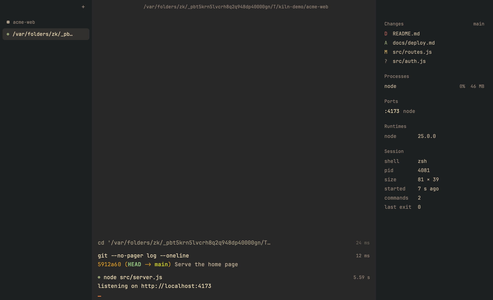

# Kiln

A calm terminal for macOS, Windows (PowerShell and WSL) and Linux. Each command becomes a block
you can copy, rerun, pin or open as a log; the prompt stays your shell's own (autosuggestions,
highlighting and fzf keep working); and the last output copies as a paste-ready Markdown block
with ⌘⇧C. No AI, no telemetry: the only network use is checking for updates.



## Install

Download from the [Releases](https://github.com/MaxB-Coder/kiln/releases) page (weekly), or
build the installers with `scripts/package.sh`. Kiln does not use paid code signing, so each
system asks once before the first launch:

- **macOS** (Apple silicon, 13 or later): open the `.dmg` and drag Kiln to Applications. The
  first launch is blocked: open System Settings → Privacy & Security and choose Open Anyway.
- **Windows** (x64): run `kiln_<version>_x64-setup.exe`. It installs for you only, without
  administrator rights. SmartScreen asks first: More info → Run anyway. Kiln opens
  PowerShell; `kiln --wsl` opens your default WSL distribution.
- **Linux** (x64): the AppImage runs anywhere and updates itself:
  `chmod +x Kiln-<version>-x86_64.AppImage`, then run it (without FUSE:
  `--appimage-extract-and-run`). Or `sudo apt install ./kiln_<version>_amd64.deb`, or unpack
  the `.tar.gz`; those update through you, not in the app. Wayland and X11 both work.

Kiln checks for a new version once a day and installs it only when you say yes (the app bundle
on macOS, the installer on Windows, the AppImage on Linux).

## Build from source

Rust installs itself from `rust-toolchain.toml` through rustup.

```bash
cargo run --release -p kiln
```

Linux needs `pkg-config clang libfontconfig-dev libfreetype-dev libwayland-dev
libx11-xcb-dev libxcb1-dev libxkbcommon-dev libxkbcommon-x11-dev libvulkan-dev`.

## Use

Every shortcut, with a filter: **⌘/** (Ctrl+Shift+/ on Windows and Linux), also in ⌘K and,
on macOS, the Help menu. The ones you will use most:

| | macOS | Windows and Linux |
| --- | --- | --- |
| All keyboard shortcuts | ⌘/ | Ctrl+Shift+/ |
| New session / split right | ⌘T / ⌘D | Ctrl+Shift+T / Ctrl+Shift+D |
| Command palette (past commands, projects, sessions, actions) | ⌘K | Ctrl+Shift+K |
| Find | ⌘F | Ctrl+Shift+F |
| Copy the last output, fenced / raw | ⌘⇧C / ⌘⌥C | Ctrl+Shift+C (with no selection) / Ctrl+Shift+Alt+C |
| Select a command / add to the selection (then ⌘C or Enter copies it, Esc clears) | ⌘↑ ⌘↓ / ⇧⌘↑ ⇧⌘↓, ⇧-click | Ctrl+Shift+↑ ↓ / Ctrl+Alt+Shift+↑ ↓, Shift+click |
| Context rail: changes, processes, ports, runtimes, session | ⌘I | Ctrl+Shift+I |
| Keyboard to the rail's changes and back (↑↓ choose, Enter opens, Esc back) | ⌘⇧I | Ctrl+Alt+Shift+I |
| Focus mode | ⌘. | Ctrl+Shift+. |
| Sidebar | ⌘B | Ctrl+Shift+B |
| Rename session / project | ⌘R or F2 / ⌘⇧R | Ctrl+Shift+R or F2 / Ctrl+Alt+Shift+R |
| Sessions 1–9, next, previous | ⌘1–9, ⌘⇧], ⌘⇧[ | Ctrl+Alt+1–9, Ctrl+Tab, Ctrl+Shift+Tab |
| Text size | ⌘= ⌘- ⌘0 | Ctrl+Shift+= - 0 |
| Settings | ⌘, | Ctrl+Shift+, |

In the sidebar, double-click a session or a project (or right-click it and choose Rename) to
rename it; Enter keeps the name, Esc drops it, and an empty name brings the automatic one
back. A session's name is saved with the sessions; a project's goes into the config, and shows
in the sidebar, the header pill and the palette. Right-click a project and choose Colour (or
"Project colour" in the palette): the project and its sessions then sit on a card tinted with
it, and its header pill takes it. Auto (no card), one of sixteen colours that look the same in
every theme, or any "#rrggbb". The arrows, Enter and Esc work in the menu and the colour pop-up. The bottom of the
sidebar shows the shortcuts key; click it for the list. Drag the inner edge of the sidebar or the context rail to
resize it (double-click the edge for its default width); the terminal always keeps at least 40
columns, and the widths come back with your sessions.

Click a file in the rail's Changes (or "Show changes" in the palette) for its diff against
HEAD, staged and unstaged together: unified or side by side, with line numbers. Select with
the mouse (double-click a word, triple-click a line, shift-click to extend); ⌘C copies just
the code, ⌘A the whole new side, "Copy diff" a patch `git apply` takes. ↑↓ or j/k scroll,
Space pages, n/p jump between hunks, [ and ] between files, ⌘F finds, ⌘O opens the file at the first change
where Settings' "Open files in" says (`$VISUAL`/`$EDITOR`, an installed IDE, or the default
app), Esc closes. It follows the file as it changes.

A pinned command (Pin in a block's hover actions) stays at the top of the timeline, through
`clear`, with its first lines; a click shows more.

Kiln loads its shell integration for zsh, bash and PowerShell by itself, without touching your
startup files. Other shells (fish, nu) get a classic terminal. Inside Kiln the prompt is a
small flame Kiln draws in the input box (muted red after a failed command; it holds still
without focus or with reduced motion); the shell prints only blank cells there, Starship
included. Your line editor, plugins and completion stay as they are, and outside Kiln your
prompt is unchanged. `[shell] prompt = "shell"` keeps your own prompt in Kiln too. Each pane's
header shows the project and the branch with its change count; the runtimes the project uses
are in the context rail (⌘I). Each command shows its time when it took a second or more, and
paths in your home folder read `~/…` (copies keep the command as typed).

## Settings

**⌘,** (Ctrl+Shift+, on Windows and Linux) opens Settings: the app icon (Kiln, Flame, Beehive or
Line, each in seven colours, or an image of your own), the theme (Kiln Dark, Kiln Light, Follow system, Catppuccin Mocha, Everforest, Nord,
Kanagawa or Custom, with every colour editable), font size, blinking cursor, sidebar, prompt, reopening sessions, notifications, remote
tints, Option as Alt (macOS) and update checks. A change applies at once and is written into
`~/.config/kiln/kiln.toml` (`%APPDATA%\Kiln\kiln.toml` on Windows), changing only that line:
your comments and other settings stay as they are. A file with an error is shown, never
written over. Everything else (theme colours, the shell, projects) lives in the file: "Open
config file" in Settings (or the palette) opens it with every option and its default, and
changes apply as you save. A few:

```toml
icon = "beehive"                # the app icon: "kiln", "flame", "beehive", "line" or "custom"
font_size = 13.0
notify_after_secs = 10          # notify when a long command finishes out of sight (0: off)
editor = "auto"                 # ⌘O in the changes viewer: "auto" ($EDITOR), "system", "IntelliJ IDEA", "code", …

[shell]
prompt = "kiln"                 # a small flame in the input box; "shell": your prompt's last line (e.g. ❯)

[icon_colours]                  # each design keeps its own colour (terracotta when not set)
beehive = "slate"               # terracotta, black, white, ember, slate, sage or sand

[window]
restore = true                  # reopen the last sessions at launch

[tints]
production = ["*prod*"]         # ssh hosts that get the red tint

[updates]
check = true                    # once a day; nothing installs without asking

[projects."~/code/app"]
name = "App"                    # shown instead of the folder's name
color = "blue"                  # one of sixteen names (red … grey), or "#rrggbb"

[theme]
name = "nord"                   # or kiln-dark, kiln-light, system, catppuccin-mocha, everforest, kanagawa, custom

[theme.custom]                  # used when name = "custom"; kept while you use a preset
base = "everforest"             # the preset it starts from
accent = "#ff3d8b"              # any palette colour, as "#rrggbb"
```

## Privacy and security

- No telemetry. Release builds check for updates once a day when they know where to look;
  updates are signed (minisign) and checked before anything is replaced, and install only when
  you choose to. `[updates] check = false` turns this off.
- Programs may set the clipboard, never read it (OSC 52 reads are off). Opening a port from
  the rail asks first.
- Entering a folder never runs a repository's hooks or fsmonitor (git status runs with them
  off).
- Logs, saved sessions and shell-integration scripts are private to your user.
- Notifications show only a command's program and first argument.

## Development

```bash
cargo test --workspace
cargo run -p kiln --example snapshot -- /tmp/shots phase2   # headless screenshots
scripts/linux-check.sh                                       # Linux build and tests in a container
scripts/package.sh                                           # installers for this platform
```

`PLAN.md` is the plan; `notes/` has each phase's report, the decisions made along the way
(`DECISIONS.md`) and open questions (`QUESTIONS.md`).

Releases: `.github/workflows/release.yml` builds, installs and starts the installers on all
three systems and publishes only when asked. Its header lists the optional settings: update
address and key, Developer ID signing and notarisation, Azure Trusted Signing.

To turn on signed in-app updates and weekly releases, run `./scripts/setup-updates.sh` once. It
makes the update-signing key, stores it as GitHub secrets, sets the update address and public
key, and walks you through backing the key up.

## Licence

Kiln is licensed under either of

- Apache License, Version 2.0 ([LICENSE-APACHE](LICENSE-APACHE))
- MIT license ([LICENSE-MIT](LICENSE-MIT))

at your option. One file is the exception: `crates/kiln_term/src/pty_loop.rs` is adapted from
alacritty_terminal's event loop and stays under Apache-2.0 only.

Unless you explicitly state otherwise, any contribution you submit for inclusion in Kiln, as
defined in the Apache-2.0 licence, is dual licensed as above, without any additional terms.

Kiln bundles JetBrains Mono (SIL OFL 1.1) with Nerd Fonts patches (MIT). The Catppuccin
Mocha, Everforest, Nord and Kanagawa themes use those projects' palettes (MIT; see
`assets/themes/THEME-LICENSES.md`). Every package carries both Kiln licences, the font and
theme licences, and `THIRD_PARTY_LICENSES.md` with the licences of all the crates in the
binary.
