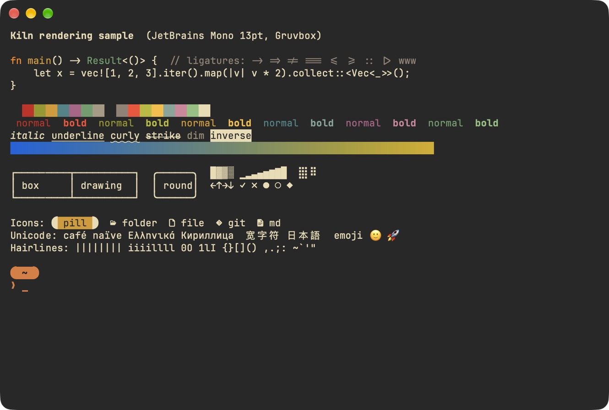
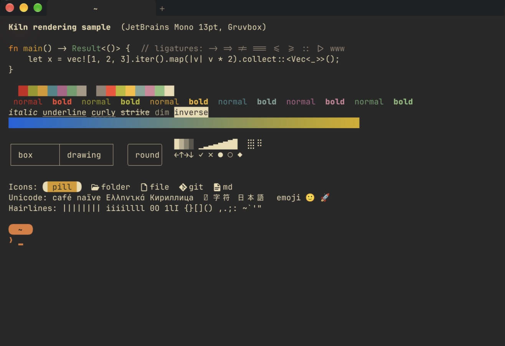
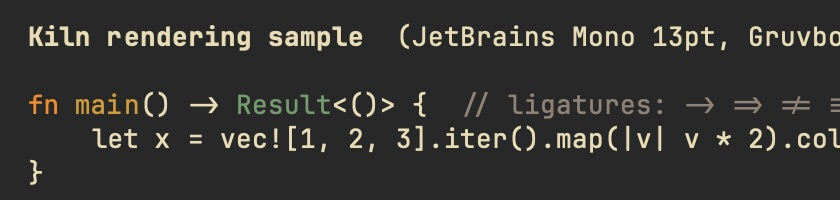
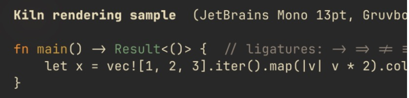
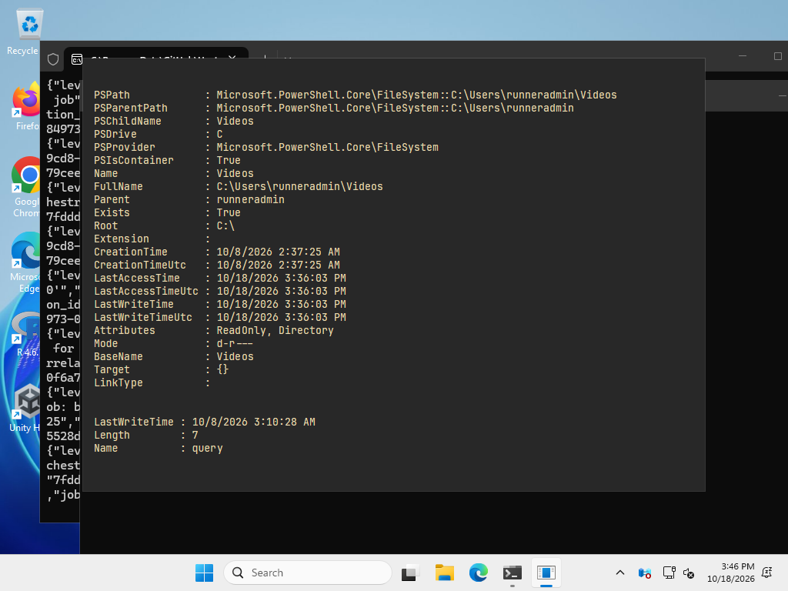
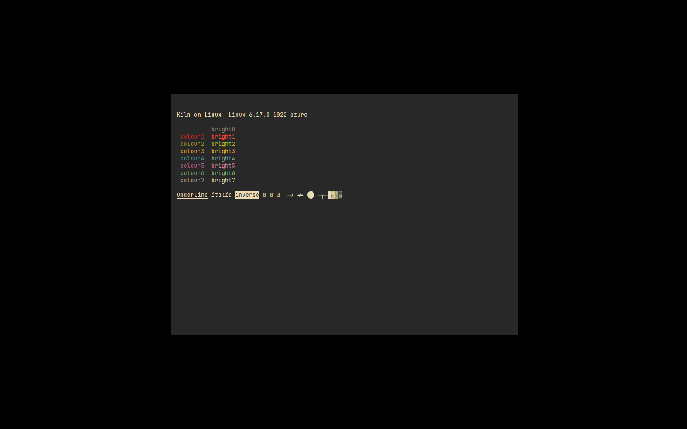

# Phase 0 spike: results and go/no-go

Date: 2026-10-18. Mac: MacBook (Apple silicon, built-in 60 Hz Retina panel), macOS 27.0.1.
WezTerm: your patched build 20261018-114323-bba370b6 with your normal `wezterm.lua`.
Kiln: commit on `main`, release build, GPUI at Zed `56934ec`, alacritty_terminal 0.26.0.

## Recommendation: go

Go with GPUI + alacritty_terminal, with three conditions:

1. **Test Windows on real hardware in the first week of phase 1.** It builds, runs PowerShell
   and WSL on ConPTY and draws correctly on a GitHub runner, but that runner renders in
   software. GPUI has open Windows bugs that matter to a terminal (see "GPUI on Windows and
   Linux"). If key repeat stalls the window on your machine, fix it in GPUI (Apache-2.0, small
   upstream PR) before building more UI on top.
2. **Keep the UI swappable.** All terminal logic lives in `kiln_term`, which has no UI code.
   If GPUI on Windows or Linux turned out unworkable, only the `kiln` crate (about 1,700 lines
   today) would be redone.
3. **Pin GPUI by commit and bump it weekly through CI.** GPUI is not released on crates.io in
   step with Zed, so it comes from Zed's repository at a fixed commit (details below).

On macOS the prototype already beats WezTerm on startup and memory, matches it on throughput,
and renders text the same way.

## Done criteria

| # | Criterion | Status |
| --- | --- | --- |
| 1 | macOS window runs login `zsh -l`, JetBrains Mono 13pt, the palette; typing, resize, scrollback, selection, copy/paste; nvim full screen | Done and checked on this Mac, except ⌘C/⌘V end to end (see "Still to check") |
| 2 | Builds and runs on Windows (PowerShell, WSL Ubuntu) and Linux; GitHub Actions matrix | Done in CI: build, tests and a smoke run on all three. Not yet tried on your own Windows or Linux machines |
| 3 | Notes comparing with WezTerm: latency, memory, startup, rendering, screenshots | This file. Keystroke latency end to end needs you (see below) |
| 4 | Go/no-go, GPUI's Windows and Linux maturity, plan changes | Above, and the last sections |

## What was built

```
kiln/
  crates/kiln_term/   no UI code; tested headless on every OS
    shell.rs          login shell on Unix, PowerShell or WSL on Windows
    pty_loop.rs       PTY read/write loop (adapted from alacritty's, Apache-2.0)
    marks.rs          OSC 133 / OSC 7 scanner: prompt, command, output, exit code, folder
    input.rs          keys, mouse (SGR and X10), bracketed paste
    session.rs        one shell + one engine; events to the UI
  crates/kiln/        the GPUI app
    terminal_element  draws the grid: text runs on a cell grid, backgrounds, cursor, selection, IME text
    terminal_view     input, selection, clipboard, scrolling, session events
    workspace         root view: where the sidebar, input bar and splits go in phase 1
  assets/fonts/       JetBrains Mono Nerd Font, embedded in the binary
  bench/              comparison scripts, rendering sample, latency procedure
```

- alacritty_terminal is an unmodified crates.io dependency.
- Kiln runs its own copy of alacritty's PTY loop. It feeds the engine up to each OSC 133 or
  OSC 7 mark and records the cursor position at that exact point. Blocks in phase 1 build on
  this. A test on a real PTY (macOS, Windows/ConPTY and Linux in CI) checks the marks.
- Programs may set the clipboard (OSC 52) but never read it. The engine has no
  "report window title" sequence, so the title never goes back to programs.
- Release binary: 18 MB (10 MB of it is the four embedded font files). Cold debug build of
  GPUI: 4 min; release build: under 3 min on this Mac.

## Measurements (this Mac, same command and 120×36 grid in both)

Method: `bench/compare.py`. Both apps start `zsh -l` from the shell with the same command, your
real WezTerm config, 8 timed runs after one warm-up, median shown. Memory is macOS
"physical footprint" (what Activity Monitor shows) of the GUI process only. Raw numbers:
`notes/bench-2026-10-18.json`.

| | Kiln | WezTerm | |
| --- | --- | --- | --- |
| Launch to window on screen | **253 ms** | 488 ms | Kiln about 2× faster |
| Launch to shell process running | **235 ms** | 410 ms | |
| Launch to your interactive prompt drawn (starship) | 310 ms | not measurable from outside | Kiln's own timer, `--bench-startup` |
| Memory, idle at a prompt | **47 MB** | 59 MB | |
| Memory after ~25 MB of output (scrollback full, 10,000 lines) | **91 MB** | 101 MB | |
| `seq 1 2000000` through the terminal | 3.01 s | 3.05 s | Same: the PTY and shell are the limit, not the terminal |
| 200,000 coloured lines | 1.64 s | 1.75 s | |

Caveats:
- Your WezTerm config has 0.97 opacity and background blur; Kiln is opaque. That costs WezTerm
  some GPU memory and startup time, but it is how you use it.
- Kiln compiles its Metal shaders at startup (`runtime_shaders`, so it builds without Xcode).
  Release builds made on CI with Xcode can precompile them and start a little faster.
- Your long-running WezTerm session uses 145 MB; a fresh window uses 59 MB. Memory grows with
  scrollback in both.

### Keystroke latency

- **Kiln's own share** (key received to the frame with the echo painted, `cat`, 20 keys,
  `KILN_TRACE_LATENCY=1`): median **9.6 ms**, min 1.5 ms, max 38 ms. Most of the spread is
  waiting for the next 60 Hz frame. Add the OS input path, the wait for the display refresh and
  the panel itself for the full figure.
- **End to end, Kiln against WezTerm: not measured yet.** It needs a tool that injects keys
  and reads the screen. I was not allowed to type into WezTerm, so this one is yours:
  `bench/LATENCY.md` (Typometer, or slow-motion phone video). Put the numbers here.

## Rendering

Same sample (`bench/sample.sh`) in both, 100×30. Kiln window capture vs a display capture of
WezTerm, so do not compare sharpness pixel for pixel; by eye both are crisp.

| Kiln | WezTerm |
| --- | --- |
|  |  |
|  |  |

- Same font, size, weights, ligatures, colours (16-colour, 256 and truecolor), underline
  styles, inverse, dim, emoji, starship pill.
- Kiln draws `宽` (via CoreText fallback); WezTerm shows a missing-glyph box for it.
- Kiln's Nerd icons are smaller: the "Mono" variant of the patched font fits each icon in one
  cell, WezTerm lets them overflow. Fixable in phase 1 (let icon glyphs spill into the next
  cell when it is empty).
- Box drawing in Kiln comes from the font glyphs and can show hairline seams at some sizes.
  WezTerm draws box and block characters itself. Phase 1 should do the same.

Other platforms (GitHub runners, software rendering, so only correctness):

| Windows, PowerShell on ConPTY | Linux, X11 under Xvfb, Vulkan (lavapipe) |
| --- | --- |
|  |  |

The WSL job passed (a frame with output from the WSL Ubuntu session was drawn), but its
screenshot missed the window because of a quoting bug in the script, now fixed; it runs weekly.
The missing glyphs in the Linux shot are CJK characters: the runner has no CJK font.

## Findings that change the plan

1. **Window chrome is phase 1 work on Windows and Linux, not polish.** With the native title
   bar hidden, the Windows build has no controls yet (see the screenshot), and GNOME on Wayland
   gives GPUI apps no title bar at all. Kiln must draw the Windows 11 controls and, on Linux,
   its own title bar and resize edges. Zed does both with GPUI, so it is known to work.
2. **Blocks need an anchoring design.** alacritty_terminal has no line identity: rows shift
   when scrollback trims or the window reflows. Two options for phase 1: freeze each finished
   command into its own small grid (as Warp does), which also makes Copy, Open log and dimming
   old commands simple; or track scroll offsets. I recommend frozen per-block grids.
3. **Fonts ship inside the app.** GPUI refuses fonts without an `m` glyph (symbol-only fonts)
   and, on macOS, its fallback list cannot see fonts embedded in the binary. Kiln therefore
   embeds the Nerd Fonts-patched JetBrains Mono. Renovate cannot update it; check it at
   release time (`assets/fonts/README.md`).
4. **Windows build is a console app for now**, so starting it from Explorer also opens a
   console window. Switch to the Windows subsystem with logging to a file in phase 1.
5. **CI cost.** A cold full run is about 130 billed minutes on a private repo (Windows 2×,
   macOS 10×); the free plan has 2,000 a month. The WSL job now runs weekly and on demand only.
   With caches warm a push costs roughly 40–60 billed minutes. A public repo would make it free.

## GPUI on Windows and Linux

- **Status**: Zed ships on Windows and Linux on GPUI, so the basics are in daily use. Zed's
  tracker today: 104 open Windows issues, 84 Linux (34 Wayland, 19 X11), 47 macOS. Few are
  GPUI-level, but some matter to a terminal:
  - Windows: window stops presenting for seconds under sustained keyboard input
    ([zed#61469](https://github.com/zed-industries/zed/issues/61469)) — key repeat in a
    terminal would hit this; phantom Alt key events when a window activates
    ([zed#62404](https://github.com/zed-industries/zed/issues/62404)) — Alt sends ESC in a
    terminal; several wheel reports per notch
    ([zed#64695](https://github.com/zed-industries/zed/issues/64695)).
  - Linux: no recovery after GPU device loss
    ([zed#23288](https://github.com/zed-industries/zed/issues/23288)); extra repaints from
    missing damage regions ([zed#15166](https://github.com/zed-industries/zed/issues/15166)).
- **Rendering**: Windows uses Direct3D 11 with DirectWrite; Linux uses wgpu (Vulkan) with
  cosmic-text, on Wayland and X11. Both worked first time in CI with software rendering.
- **Packaging GPUI**: crates.io `gpui` stopped at 0.2.2 (Oct 2025). Options are a git pin on
  Zed (chosen: official source, exact commit) or third-party snapshots (`gpui-pre`, published
  weekly by the gpui-component maintainer; `gpui-ce`, a community fork). With the git pin,
  Zed's `[patch.crates-io]` entries do not apply, so Kiln repeats the four that GPUI needs;
  re-check them on each bump. Renovate proposes the bump weekly; CI is the gate.
- **Supply chain**: cargo-deny passes. GPUI pulls in six crates flagged unmaintained
  (`paste`, `rustybuzz`, `ttf-parser`, `zbus_names`, `zvariant`, `zvariant_derive`); no known
  vulnerabilities. Vulnerabilities fail CI anywhere in the graph; unmaintained notices only
  for Kiln's direct dependencies.
- **Zed's terminal** uses a fork of alacritty_terminal that only adds a signal-mask option.
  Kiln uses the upstream crate as is.

## Still to check (you)

- ⌘C / ⌘V end to end on macOS (my tools may not touch the clipboard; selection and the paste
  encoding are tested).
- Dead keys and compose (Option+E, then E → é) on macOS.
- Windows on your PC: PowerShell and `kiln --wsl`, key repeat in nvim, Alt+key in the shell,
  mouse wheel in a pager. Linux on a real desktop, Wayland and X11.
- End-to-end keystroke latency against WezTerm: `bench/LATENCY.md`.

## How to run it

```bash
scripts/bundle-macos.sh release && open target/release/Kiln.app
target/release/kiln --cols 120 --rows 36 -- /bin/zsh -l
python3 bench/compare.py --runs 8
```

On Windows: `kiln.exe` (PowerShell 7 if installed), `kiln.exe --wsl`, or
`kiln.exe -- wsl.exe --distribution Ubuntu`.
