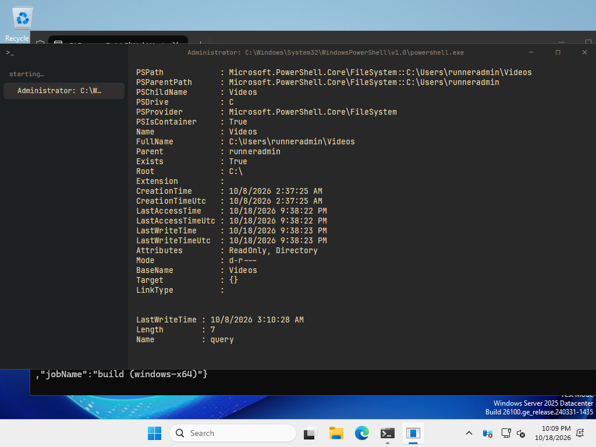

# Phase 1: daily driver

Date: 2026-10-18. All screenshots are real renders of the app (real shells on real PTYs, real
text shaping, real GPU rendering), made headless with `cargo run -p kiln --example snapshot`,
because the Mac's screen was locked while this was built. The same tool runs in CI.

## What works

| Plan item | Status | Screenshot |
| --- | --- | --- |
| Blocks: one per command, old ones dim, hover actions Copy / Rerun / Pin / Open log, failures as a small dot | Done | [02](screenshots/phase1/02-blocks.png), [03](screenshots/phase1/03-hover-actions.png) |
| Commands bright, output muted (program colours kept), metadata dim | Done | [02](screenshots/phase1/02-blocks.png) |
| Rendering: box drawing, blocks, eighths and shades drawn seamlessly; `clear` empties the timeline | Done | [02b](screenshots/phase1/02b-rendering-sample.png) |
| Running command shown live, with a green dot and elapsed time | Done | [04](screenshots/phase1/04-running.png) |
| Input bar pinned at the bottom: the shell's own prompt and line editor (autosuggestions, highlighting, fzf all keep working) | Done | [01](screenshots/phase1/01-prompt.png) |
| Dim context in the input bar: Node version in JS projects, `WSL · distro` on Windows | Done (not in the shots: this repo is not a JS project) | |
| Sidebar: sessions grouped by project, status dots | Done | [09](screenshots/phase1/09-sessions.png) |
| Splits side by side (⌘D) | Done | [08](screenshots/phase1/08-split.png) |
| Find (⌘F) with highlights and a match count | Done | [05](screenshots/phase1/05-find.png) |
| Palette basics (⌘K): actions, sessions, past commands | Done | [06](screenshots/phase1/06-palette.png) |
| Copy last output (⌘⇧C) as a paste-ready fenced block; ⌘⌥C raw | Done | [07](screenshots/phase1/07-copy-last-output.md) |
| Config and theme: `kiln.toml`, live reload, palette overrides, text size | Done | |
| Full-screen apps take the whole pane | Done | [10](screenshots/phase1/10-fullscreen-nvim.png) |
| Windows 11 controls and `>_` mark; Ctrl+Shift for every ⌘ shortcut | Done, previewed on the Mac | [11](screenshots/phase1/11-windows-chrome-preview.png), [12](screenshots/phase1/12-windows-chrome-with-sidebar.png) |
| Linux: own title bar and resize edges | Done, not seen on a real Linux desktop | |

The copy from screenshot 07, exactly as it lands on the clipboard:

````markdown
```console
~/developer/kiln $ for i in 1 2 3 4 5 6; do echo "tick $i"; sleep 1; done
tick 1
…
tick 6
# exit 0 · 6.07 s
```
````

## How it is built

- **Shell integration** (`crates/kiln_term/shell/`): zsh, bash and PowerShell scripts mark the
  prompt, the command line and its exit code (OSC 133) and the folder (OSC 7). Kiln loads them
  without touching any startup file (details in `DECISIONS.md`). Shells without integration
  (fish, nu, ssh to another machine) get the classic full terminal.
- **Block recorder** (`blocks.rs`): runs on the PTY thread at each mark, with the engine fed
  exactly up to the mark. A finished command's output is copied out of the live grid, so
  blocks survive scrollback limits and re-wrap when panes resize (screenshot 08).
- **Timeline** (`terminal_view.rs`, `block_element.rs`, `live_element.rs`): a virtualised list
  of frozen blocks, then the running command drawn straight from the live grid, then the prompt
  in the input bar. Only rows in view are laid out, so a 10,000-line block costs what is
  visible.
- **Workspace** (`workspace.rs`): sessions, splits, sidebar, find bar, palette, title strip.

## Tests

- 36 unit and integration tests. Real shells on real PTYs record the right command, output
  and exit code for zsh, bash 5, bash 3.2, PowerShell 7 and Windows PowerShell 5.1.
- CI ([MaxB-Coder/kiln](https://github.com/MaxB-Coder/kiln/actions), private): all six jobs
  green on the last run: macOS arm64, Linux x64, Windows x64 (tests, a PowerShell session on
  ConPTY), a WSL Ubuntu session, clippy with warnings as errors, and cargo-deny. macOS and
  Linux CI also render the headless screenshots and keep them as artifacts.
- Linux on this Mac: `scripts/linux-check.sh` builds and tests in a container (Debian, bash,
  PowerShell 7, software Vulkan) and renders the screenshots in `screenshots/linux/`.

Windows, from CI (PowerShell without integration, so the classic grid; real Windows 11
controls at the top right):



Bugs CI and the container caught and fixed: the UTF-8 locale was never set (non-ASCII input
broke in fresh environments); PowerShell's cursor-position query went unanswered without a UI
(it now gets answered on the PTY thread); the PowerShell script called a PSReadLine API that
newer versions removed, and Windows blocks `.ps1` files by default (it now loads inline);
bash 3.2's command line came back cut short (it now gets a proper output mark).

## Not done or not verified

- **Partly tried in the real window.** With access granted later, keystrokes went through the
  real macOS path (key events, input method, PTY): `echo héllo-宽` and a failing `ls` were
  recorded with the exact command line, exit codes 0 and 2, and the folder change. The window
  stayed behind the user's work, where macOS pauses drawing, so the visuals come from the
  headless renders. Still to try by hand: mouse selection across blocks, the title-bar drag,
  and IME composition.
- Splits are equal width (no dragging) and side by side only.
- Sessions and layouts are not restored after a restart (phase 2: project spaces with layouts).

## Next: phase 2

Context rail (⌘I: changes, running processes and ports, runtimes, session), live process
tracking, notifications, project spaces with layouts and colours, focus mode (⌘.), SSH and
production tints.
