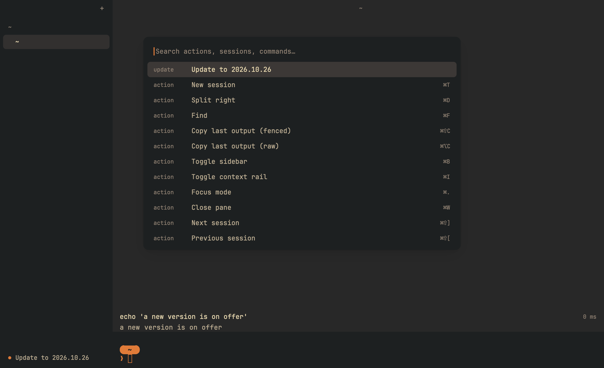

# Phase 3: ship

Date: 2026-10-19. The plan: signed installers, the cargo-packager updater, Renovate, cargo
deny/audit, weekly releases. Within the limits set for this build (nothing that costs money,
nothing published), all of it is built and tested, and the paid or public parts are switched
off until you decide (`QUESTIONS.md`).

## What works

| Plan item | Status |
| --- | --- |
| Installers | macOS `Kiln.app` + dmg, Windows per-user NSIS installer, Linux `.deb` + tarball, from `scripts/package.sh` (cargo-packager). CI builds each one, installs it, and starts Kiln from the installed copy. |
| Signed | Ad hoc on macOS, unsigned on Windows: real signing costs money. The workflow signs with Developer ID (and notarises) and with Azure Trusted Signing as soon as the secrets exist. |
| Updater | Built and tested end to end. Off until there is somewhere public to update from and a signing key. |
| Renovate | Config covers GPUI, the engine, crates, Rust, cargo-packager and cargo-about, Actions, the test image, and security fixes at any time. Needs the Renovate app installed. |
| cargo deny / audit | `cargo deny` on every push, and a daily RustSec advisories check (`security.yml`). |
| Weekly releases | `release.yml`, weekly on Mondays once `KILN_RELEASES=on`; by hand any time. Versions are dates. |
| App icon | New: a kiln's arch with the prompt glowing inside. |
| Licences in every package | `THIRD_PARTY_LICENSES.md` (all crates in the binary, made by cargo-about) and the font licences. |

The update offer, shown with a made-up update (screenshots `phase3/`):

## The updater

- Checks only in builds that carry an update address and public key (set by the release
  workflow) and that were installed by a Kiln installer. A minute after launch, then daily.
- Reads `latest.json` over HTTPS (256 KB at most), offers a newer version in one quiet sidebar
  line and as the first palette item, and installs only after a yes.
- The download must carry a valid minisign signature from the build's key before anything is
  replaced. Then cargo-packager's updater swaps the app bundle (macOS) or runs the new installer
  (Windows; Kiln closes and says so first), and Kiln offers to restart. Sessions reopen in their
  folders.
- Kiln reads the manifest itself instead of with the crate's check, which sets `SSL_CERT_FILE`
  for the whole process on Linux: every shell would have inherited it.
- Tests (`crates/kiln/tests/update.rs`) run a local server: a newer release is offered and an
  older one is not; a tampered download is refused and nothing is touched; on macOS a signed
  update replaces a stand-in app bundle; and the manifest the release script writes reads back.

## Tests

- 56 tests in all, 6 of them new: the four updater tests above, and unit tests that update
  addresses must be HTTPS and that development builds never update themselves.
- Release workflow, run by hand without publishing: see the CI section below.
- Local: the macOS app and dmg built here; `codesign --verify --deep --strict` passes;
  `hdiutil verify` passes; Gatekeeper rejects it, as expected without notarisation.

## CI

(filled in below once the runs finish)

## Not done or not verified

- Real signing and notarisation, publishing, and an update served from a real address: all
  wait on your decisions (`QUESTIONS.md`).
- Intel Macs: releases are Apple silicon only (GitHub's Intel runners are being retired). A
  universal build is possible if you need one.
- Linux AppImage and Linux in-app updates (see DECISIONS: unpinned build tools).
- The installers by hand on real Windows and Linux desktops.
